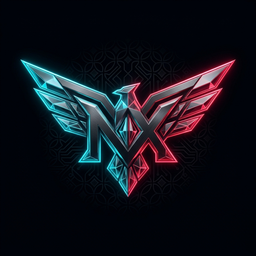

# NusaNx

**On-device Nintendo Switch (`.nsp` / `.xci`) to native iOS / iPadOS ARM64 & Apple Metal Studio**

---

## Overview

**NusaNx** transforms legal Nintendo Switch game containers into standalone native iOS / iPadOS `.ipa` applications directly on-device — no companion Mac or external JIT server required during conversion.

Game binaries run natively on Apple Silicon ARM64 while Switch graphics shaders are translated directly into **Apple Metal** on-device.

---

## Highlights

- **On-Device Packaging Pipeline:** Decrypts `.nsp` / `.xci` containers locally with your own `prod.keys`, rewrites ARM64 modules, indexes `RomFS.img`, and packages an installable `.ipa`.
- **On-Device Route B Metal Shaders:** Translates Switch NVN and OpenGL shaders into Metal Shading Language directly on iPad without dynamic shader JIT.
- **Game Artwork & Metadata:** Automatically extracts title metadata and game cover icons from game containers and embeds full iOS/iPadOS `AppIcon` assets into generated `.ipa` files.
- **Multi-Style Studio UI:** Switch live between *Switch Neon*, *Cyber OLED*, *Midnight Pro*, and *Solar Forge* themes, with an adaptive two-column iPad cockpit, built-in SHA-256 IPA verification, and a filterable telemetry console.

---

## Beta Releases

> **NusaNx is currently in active Beta.**  
> Official `.ipa` builds and changelogs will be published on the **Releases** page once public beta builds open. No pre-built releases are available yet.

---

## Community

Join the official Discord server for beta updates, game compatibility notes, and testing discussion:

- **Discord:** [https://discord.gg/gme54SrAZn](https://discord.gg/gme54SrAZn)

---

## Requirements

- **iPad:** Apple M1 chip or newer (`iPadOS 26.0+`)
- **iPhone:** Apple A17 Pro chip or newer (`iOS 26.0+`)
- **Sideloading:** LiveContainer, SideStore, or AltStore *(enable **Increased Memory Limit** for larger titles)*
- **User Files:** Your own legal `prod.keys` and `.nsp` / `.xci` backups

---

## Legal Notice

NusaNx is an independent software project and is not affiliated with Nintendo Co., Ltd. or Apple Inc. This repository contains **zero** decryption keys, firmware files, or copyrighted game assets.

---

## References

Technical inspiration & open-source references: **Ryujinx**, **SPIRV-Cross**, **Atmosphère**, **LibHac**, and **nxnative**.
